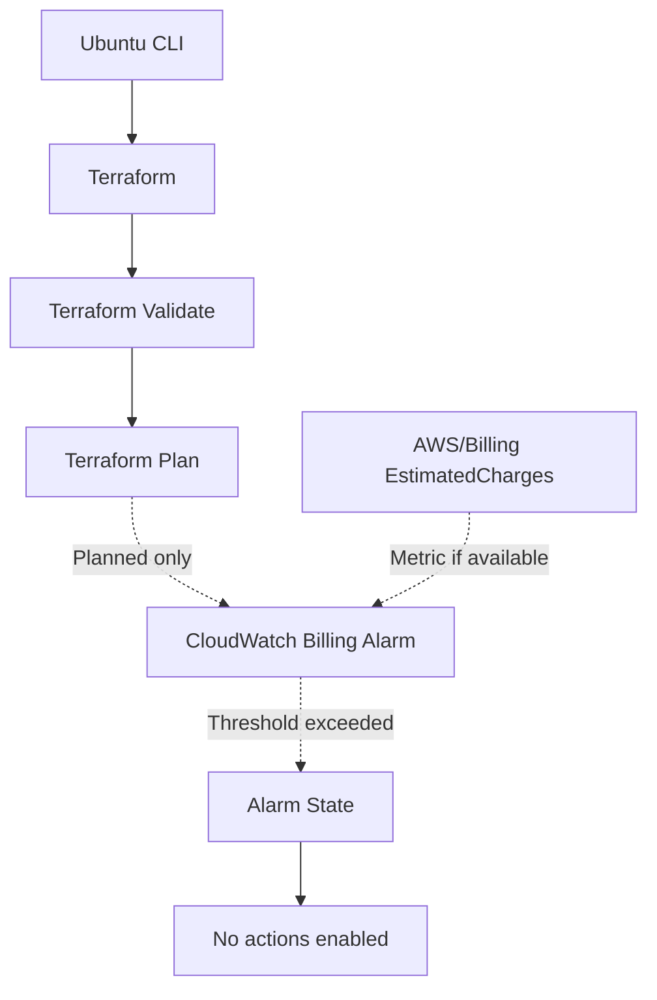
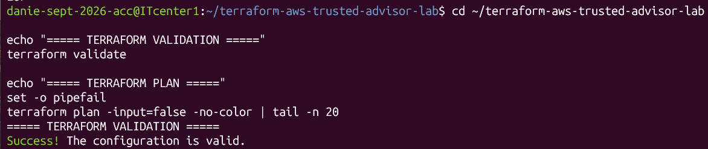

# AWS Governance Billing Monitoring Terraform Lab

## Project Status

**PLAN ONLY — No AWS resources deployed by this project.**

## Project Overview

This project demonstrates AWS cost-governance monitoring using Terraform and Amazon CloudWatch.

It was developed as a Trusted Advisor-inspired learning exercise after the AWS Trusted Advisor ListChecks API returned an access error due to the account's support level.

This project does not create or manage AWS Trusted Advisor checks.

The proposed CloudWatch alarm monitors the AWS/Billing EstimatedCharges metric against a $10 USD threshold.

## Architecture



The architecture illustrates the proposed monitoring workflow, not deployed infrastructure.

## Technology Stack

- Terraform
- AWS CLI
- Amazon CloudWatch
- AWS Billing metrics
- Ubuntu Linux
- Git and GitHub

## Planned Terraform Resource

| Resource | Purpose | Status |
|---|---|---|
| `aws_cloudwatch_metric_alarm.billing_estimate` | Monitor estimated AWS charges | Planned only |

## Alarm Configuration

- AWS Region: `us-east-1`
- Alarm name: `terraform-governance-billing-estimate`
- Namespace: `AWS/Billing`
- Metric: `EstimatedCharges`
- Currency: `USD`
- Threshold: $10
- Comparison: `GreaterThanThreshold`
- Evaluation periods: 1
- Period: 21600 seconds (6 hours)
- Statistic: `Maximum`
- Missing data treatment: `missing`
- Alarm actions: Disabled

The threshold is an alerting condition, not a spending limit.

## AWS Environment Discovery

Read-only AWS CLI checks identified:

- AWS account: `774305591665`
- Trusted Advisor ListChecks: AccessDeniedException due to support level
- No existing CloudWatch metric alarms returned for the project prefix
- No AWS/Billing EstimatedCharges metrics returned by the discovery query

These findings do not prove that billing metrics are disabled.

## Terraform Validation

Commands:

```bash
terraform init
terraform fmt -check
terraform validate
terraform plan -input=false -no-color
```

Observed results:

- Terraform formatting passed.
- Terraform validation succeeded.
- Terraform plan succeeded.
- Plan: 1 to add, 0 to change, 0 to destroy.

No Terraform apply was executed.

## Validation Evidence

See [Validation Evidence](docs/validation-evidence.md).



## Security Considerations

- Do not commit AWS credentials or private keys.
- Do not commit Terraform state files.
- Use least-privilege IAM permissions.
- Do not change AWS Support plans without authorization.
- Do not treat a billing alarm as a spending cap.

## Cost Considerations

CloudWatch alarms can incur charges if deployed.

Billing metrics must be available for the alarm to receive measurements.

The example does not configure SNS notifications or automated remediation.

## Future Improvements

- Review billing metric availability and account billing preferences.
- Evaluate AWS Budgets as an alternative cost-monitoring service.
- Configure authorized notifications in a future deployment.
- Revisit Trusted Advisor API access if the account's support eligibility changes.

## Project Outcome

Successfully created and validated a Terraform configuration proposing one CloudWatch billing alarm.

This project demonstrates a cost-governance monitoring concept without deploying resources.
